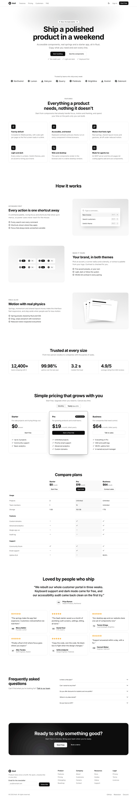

# Atoll Pro v1: what's in it

The public list of Atoll Pro items; [catalog.json](catalog.json) is the same list for the docs site and tools. The sources are only in the private Pro repository ([README.md](README.md) explains how buyers get access and how the repository is built). Every item follows the free kit's rules: kit components only, theme tokens only (light, dark and every accent), keyboard access, axe-clean, and motion through the motion layer that turns off under reduced motion.

| Item | Kind | What it is | Screenshots |
| --- | --- | --- | --- |
| `header_01` | block | **Header**: Sticky marketing header: page links, light/dark switch, sign in, a call to action, and a menu sheet on phones. | [light](screenshots/header_01-light.png) |
| `hero_01` | block | **Hero, centred**: Announcement pill, a headline whose words rise in one by one, a pitch, two actions and reassurances. Holds the page's h1. | [light](screenshots/hero_01-light.png) [dark](screenshots/hero_01-dark.png) |
| `hero_02` | block | **Hero, split**: Headline and email sign-up beside a product preview that floats in while its numbers count up. | [light](screenshots/hero_02-light.png) |
| `logo_cloud_01` | block | **Logo cloud**: Customer wordmarks as a wrapped grid or a pausable marquee. | [light](screenshots/logo_cloud_01-light.png) |
| `features_01` | block | **Feature grid**: Six icon cards that stagger in as the grid scrolls into view. | [light](screenshots/features_01-light.png) [dark](screenshots/features_01-dark.png) |
| `features_02` | block | **Feature rows**: Alternating text and picture rows; each picture slides in from its own side. | [light](screenshots/features_02-light.png) |
| `stats_01` | block | **Stats**: A band of key figures that count up with a spring the first time they are seen. | [light](screenshots/stats_01-light.png) |
| `pricing_01` | block | **Pricing tiers**: Three plans with a monthly/yearly switch: the highlight glides between options and prices spring to their new value. | [light](screenshots/pricing_01-light.png) [dark](screenshots/pricing_01-dark.png) |
| `pricing_02` | block | **Plan comparison**: A full comparison table with grouped features, named check and dash marks, and per-plan actions. | [light](screenshots/pricing_02-light.png) |
| `testimonials_01` | block | **Testimonials**: A featured quote over a masonry grid of quotes with names, roles, avatars and ratings. | [light](screenshots/testimonials_01-light.png) |
| `faq_01` | block | **FAQ**: Questions in an accordion beside a heading and a contact link. | [light](screenshots/faq_01-light.png) |
| `cta_01` | block | **Call to action**: A bold panel in the accent colour with two actions and a drifting light. | [light](screenshots/cta_01-light.png) [dark](screenshots/cta_01-dark.png) |
| `footer_01` | block | **Footer**: Newsletter sign-up, four link columns, copyright and social links. | [light](screenshots/footer_01-light.png) |
| `reveal` | motion component | **Reveal**: Plays a spring entrance the first time content scrolls into view; stagger with a delay. Content stays readable without JavaScript and under reduced motion. | in the gallery |
| `number_ticker` | motion component | **Number ticker**: Counts up to a value with a spring, and springs to each new value; screen readers hear the final value once. | in the gallery |
| `saas_starter` | template | **SaaS starter**: A whole product: landing and pricing pages, sign in and sign up with an email code, and a signed-in app with overview, projects, team, billing and settings. Web and desktop. | [light](screenshots/starter-overview-light.png) [dark](screenshots/starter-overview-dark.png) [light](screenshots/starter-projects-light.png) [light](screenshots/starter-team-light.png) [light](screenshots/starter-billing-light.png) |

The landing page above is every block on one page, as the SaaS starter's home page uses them: [light](screenshots/landing-light.png), [dark](screenshots/landing-dark.png), [phone](screenshots/landing-phone.png).

## How it is tested

In the Pro repository, `scripts/pro-e2e.sh` builds the Pro gallery and the SaaS starter and runs two browser scripts on Chromium, Firefox and WebKit:

- **Blocks**: axe (WCAG 2.2 AA and best practice) on every block and on the full landing page, in light and dark; no sideways scroll at 320px, before and after content reveals; reduced motion shows everything at once; the header menu, billing switch, FAQ, email forms and marquee by keyboard.
- **Starter**: every flow, from the pricing page to sign-up with a code, sign in, creating, renaming and deleting a project, inviting and removing a teammate, changing plan, reload, sign out; axe on every screen in light and dark.

Server-render tests (`crates/ui/tests/pro_blocks.rs`) check each block's landmark, heading level and licence file.

Quotes, names and figures in the screenshots are placeholders, not real customers.
